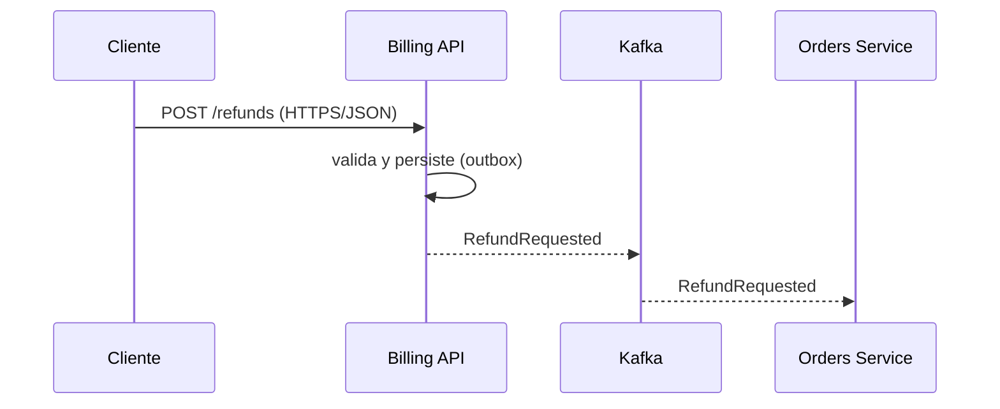

# Diagramas como código

## Cuándo aplicar y cuándo no
- Aplica a todo diagrama que viva en el repositorio: C4, secuencia, estados, ER, flujo de despliegue.
- No aplica a pizarras de descubrimiento (event storming) ni a bocetos efímeros; sus conclusiones sí pasan a texto.

## Reglas
- **MUST** guardar la fuente del diagrama como texto en el repo, junto a la documentación que ilustra; una imagen exportada sin fuente no se acepta.
- **MUST** usar herramientas de licencia abierta y gratuita (D16): Mermaid, PlantUML, Structurizr DSL (Structurizr Lite/CLI).
- **MUST** elegir una herramienta por tipo de diagrama y documentarlo en el README de docs; no mezclar tres sintaxis para lo mismo.
- **MUST** que cada diagrama tenga título, leyenda si usa colores/formas y nivel de abstracción único (ver `c4-and-arc42`).
- **MUST** mantener el diagrama en el mismo PR que el cambio que lo invalida.
- **SHOULD** preferir Mermaid en Markdown cuando basta, porque GitHub lo renderiza sin pasos extra.
- **SHOULD** modelar C4 una sola vez (modelo Structurizr) y derivar varias vistas, en lugar de redibujar.
- **SHOULD** limitar el diagrama a ~15 elementos; dividir en vistas si crece.
- **MUST NOT** incluir secretos, IPs reales ni identificadores de cuenta en diagramas.
- **MUST NOT** dibujar infraestructura AWS como "verificada"; se rotula "preparado para AWS, no verificado en real".

## Por qué
Los diagramas binarios se desactualizan y no se pueden revisar en un PR. En texto se comparan, se versionan y los agentes pueden editarlos de forma fiable. Un modelo único y varias vistas evita inconsistencias entre diagramas.

## Ejemplos
### Mal
```text
docs/arquitectura-final-v7-NUEVO.png     # sin fuente, nadie sabe quién lo editó
```
### Bien
Mermaid de secuencia en `docs/architecture/06-vista-de-ejecucion.md`:

Modelo Structurizr DSL (contenedores):
```text
workspace {
  model {
    user = person "Agente de soporte"
    shop = softwareSystem "Shop" {
      billing = container "Billing API" "Reembolsos y cobros" "Spring Boot"
      orders = container "Orders Service" "Pedidos" "Spring Boot"
    }
    user -> billing "Solicita reembolsos" "HTTPS/JSON"
    billing -> orders "Publica eventos" "Kafka"
  }
  views {
    container shop { include * autolayout lr }
  }
}
```

## Checklist de revisión
- [ ] Existe la fuente en texto junto a la doc.
- [ ] Una sola herramienta por tipo de diagrama.
- [ ] Título, leyenda y un único nivel de abstracción.
- [ ] Actualizado en el mismo PR que el cambio.
- [ ] Sin secretos ni datos de cuentas reales.

## Enforcement
| Mecanismo | Nivel | Dónde |
|---|---|---|
| Hook de parada que exige docs al cambiar código | 2 | `.claude/hooks/stop/require_docs_updated.py` |
| Check de CI que renderiza/valida sintaxis Mermaid/Structurizr | 1 | pendiente (proyecto generado) |
| Rechazo de imágenes sin fuente en PR | 3 | agente `docs-writer` / `code-reviewer` |

## Relacionados, fuentes y mantenimiento
- Relacionados: `c4-and-arc42`, `living-readme`, `adr`, `api-docs`.
- Fuentes: https://mermaid.js.org/, https://plantuml.com/, https://docs.structurizr.com/.
- Nombres, flags, versiones y sintaxis de herramientas de terceros: se fijan en el BOM del proyecto y se contrastan con la documentación de la versión adoptada (`bom-management`).
- Dueño: factory-owner · Última revisión: 2026-11-09 · Nivel: T1
